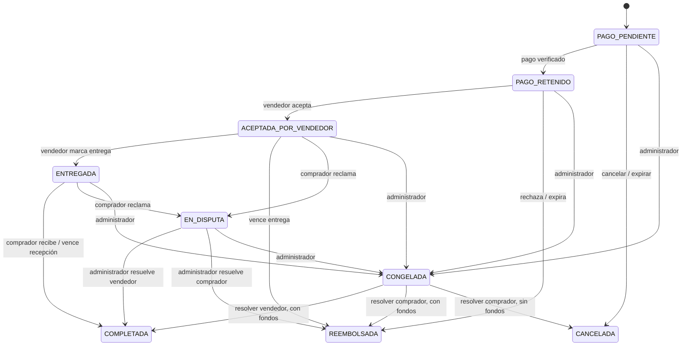

# Compra con custodia — Skins PAD

## 1. Diagnóstico y alcance

El código anterior combinaba cobro, venta y abono al vendedor en CheckoutService.stock. El checkout de saldo llamaba esa liquidación inmediatamente. No se encontró un webhook de Mercado Pago: los métodos externos se verifican manualmente. La tabla JPA real de publicaciones se llama `productos`, no `arma`.

Un pago puede incluir varias skins de diferentes vendedores. Se mantiene el carrito y se crea una **operación por skin**, con su propio vendedor, plazo, resultado y parte de la comisión. El pago sigue siendo el comprobante agregado del comprador.

Supuestos implementados:
- Simulación sin Steam. Marcar entrega no verifica un intercambio real.
- El comprador paga el precio más el 5%; se conserva el redondeo del total hacia abajo. Se reparte la comisión entre operaciones con acumulados enteros para que las partes sumen exactamente el total.
- Los reembolsos del flujo nuevo vuelven al **saldo interno**, también si el pago original fue externo. No se llama a una API real de devolución de Mercado Pago. La interfaz lo indica antes de confirmar.
- Plazos: pago pendiente 24 h, aceptación 24 h, entrega 48 h, recepción 72 h. Configurables con `escrow.pago-horas`, `escrow.aceptacion-horas`, `escrow.entrega-horas`, `escrow.recepcion-horas`.
- En una disputa o congelamiento no hay liberación por tiempo. El administrador resuelve con motivo obligatorio.

## 2. Máquina de estados y fuente de verdad



| Actual | Acción | Quién | Siguiente |
|---|---|---|---|
| PAGO_PENDIENTE | Verificar | Sistema para saldo; admin para externos | PAGO_RETENIDO |
| PAGO_PENDIENTE | Cancelar | Comprador o admin, admin con motivo | CANCELADA |
| PAGO_PENDIENTE | Expirar | Job | CANCELADA |
| PAGO_RETENIDO | Aceptar | Vendedor propietario | ACEPTADA_POR_VENDEDOR |
| PAGO_RETENIDO | Rechazar con motivo | Vendedor propietario | REEMBOLSADA |
| PAGO_RETENIDO | Expirar aceptación | Job | REEMBOLSADA |
| ACEPTADA_POR_VENDEDOR | Entregar | Vendedor propietario | ENTREGADA |
| ACEPTADA_POR_VENDEDOR | Expirar entrega | Job | REEMBOLSADA |
| ENTREGADA | Confirmar recepción | Comprador propietario | COMPLETADA |
| ENTREGADA | Liberar al vencer | Job, sin disputa ni congelamiento | COMPLETADA |
| ACEPTADA_POR_VENDEDOR / ENTREGADA | Disputar con motivo | Comprador propietario | EN_DISPUTA |
| Cualquier no terminal | Congelar con motivo | Admin | CONGELADA |
| EN_DISPUTA / CONGELADA | Resolver comprador | Admin con motivo | REEMBOLSADA; CANCELADA si no hubo retención |
| EN_DISPUTA / CONGELADA | Resolver vendedor | Admin con motivo y fondos retenidos | COMPLETADA |
| Terminal | Repetir misma acción ya ejecutada | Mismo actor autorizado | Sin nuevos efectos |

`MaquinaOperacion` concentra las transiciones; `CustodiaTransactions` añade propiedad, rol, plazos y bloqueo. No existe acción del vendedor para liberar fondos.

**Fuente de verdad:** `operaciones` para entrega y custodia. `pagos.estado=APROBADO` solo significa pago confirmado en el flujo nuevo. `pagos.liquidado` significa que todas sus operaciones terminaron, no que todas fueron exitosas. En pagos mixtos debe consultarse cada operación.

Catálogo: `INACTIVO` + `reserva_pago` durante el proceso; `VENDIDO` al completar; `ACTIVO` sin reserva al cancelar/reembolsar. Editar precio, estado o eliminar una publicación reservada queda bloqueado. Las compras nuevas reservan también los pagos externos, antes de su verificación, por un tiempo limitado.

## 3. Dinero, atomicidad y recuperación

Tablas nuevas:
- `operaciones`: instantánea de comprador, vendedor, producto, precio, comisión, porcentaje en puntos básicos, pagador de comisión, estado, fechas y orden pendiente.
- `custodia_asientos`: RETENCION, LIBERACION, COMISION y REEMBOLSO. Operación, monto CLP entero, fecha y actor. Unicidad operación/tipo; sin API para actualizar o borrar.
- `operacion_eventos`: historial persistente de acciones, actor, fecha, estado y motivo; sin API de edición.

Se agregan `custodia`, `etapa_custodia`, `error_custodia` a pagos y una restricción única sobre pedido_id. `operaciones` tiene @Version como protección adicional.

El saldo disponible continúa en usuario. Al pagar con saldo se descuenta el total una vez; el importe retenido queda representado en el libro de custodia. El vendedor no recibe saldo hasta COMPLETADA. Al liberar se registran por separado precio al vendedor y comisión de plataforma. El porcentaje y el pagador quedan fijados al cotizar; no se recalculan con un precio futuro. La comisión se reconoce al liberar, nunca al retener.

No se presenta @Transactional como una transacción distribuida. Se usa una saga persistente sencilla:
1. Crear pago y operaciones en una transacción local, antes de efectos remotos.
2. Reservar catálogo y debitar saldo con la referencia estable del pago. Si la respuesta se pierde, repetir la misma referencia.
3. Guardar retención y estado local en una transacción. Un rechazo definitivo de reserva/débito conduce a DESCARTAR; un timeout deja la orden para recuperación.
4. Para liberar o reembolsar, guardar primero acción/actor/motivo pendientes. Esa orden impide una acción incompatible mientras el resultado remoto sea incierto.
5. Ejecutar catálogo y saldo con referencias `ESCROW-LIBERAR-{operacion}` o `ESCROW-REEMBOLSO-{operacion}`. El servicio de usuario bloquea la cuenta y comprueba referencia/tipo/monto.
6. Confirmar estado, asientos y evento juntos. Si el proceso falla después del abono, el job repite la misma referencia y completa el registro sin abonar dos veces.

Bloqueo pesimista en orden **pago → operación**, aislamiento READ_COMMITTED. Evita conflictos entre acciones hermanas y lecturas antiguas antes del bloqueo. El catálogo bloquea las publicaciones por ID ordenado. El débito/abono bloquea la cuenta. Llamadas Feign: conexión 3 s, lectura 5 s. Una caída prolongada deja la operación visible como pendiente de sincronización; no se inventa un éxito ni se ejecuta una compensación monetaria ambigua.

Con varias instancias, la exclusión la proporciona la base, no `synchronized`. El job reintenta hasta 100 operaciones por barrido; para mayor escala debe usarse cola/outbox con backoff y paginación de pagos en recuperación. Actualmente no hay dead-letter queue ni alertas externas.

## 4. API y seguridad

Todos los endpoints públicos requieren `Authorization: Bearer ...`. La identidad se vuelve a validar con usuario en pago, sin confiar en X-Skins-Usuario enviado por un cliente.

| Método y ruta | Cuerpo / parámetros | Acceso y resultado |
|---|---|---|
| POST /api/pagos/checkout | solicitudId, productoIds, metodo | Cliente; Pago con custodia=true. Misma solicitud y contenido reutiliza el pago |
| GET /api/operaciones?vista=compras | estado opcional | Comprador: sus operaciones |
| GET /api/operaciones?vista=ventas | estado opcional | Vendedor: sus operaciones |
| GET /api/operaciones?vista=excepciones | estado opcional | Admin: pendientes, disputas, congeladas y errores |
| GET /api/operaciones?vista=historial | estado opcional | Admin: todas; cliente continúa limitado a sus compras |
| GET /api/operaciones/{id} | — | Participantes o admin |
| POST /api/operaciones/{id}/aceptar | {} | Vendedor |
| POST /api/operaciones/{id}/rechazar | {"motivo":"..."} | Vendedor |
| POST /api/operaciones/{id}/entregar | {} | Vendedor; simulación |
| POST /api/operaciones/{id}/recibir | {} | Comprador; libera dinero |
| POST /api/operaciones/{id}/disputar | {"motivo":"..."} | Comprador |
| POST /api/operaciones/{id}/cancelar | motivo si admin | Comprador/admin, solo pago pendiente |
| POST /api/operaciones/{id}/congelar | {"motivo":"..."} | Admin |
| POST /api/operaciones/{id}/resolver-comprador | {"motivo":"..."} | Admin |
| POST /api/operaciones/{id}/resolver-vendedor | {"motivo":"..."} | Admin |
| POST /api/operaciones/pagos/{id}/verificar | {"motivo":"evidencia de cobro"} | Admin; afecta todas las skins del pago |

Acciones devuelven `Vista { operacion, eventos, metodo, pagoAtascado }`; verificación devuelve una lista de vistas. Lista devuelve Vista[]. La acción puede responder con `accionPendiente` si falta sincronización; el frontend muestra recuperación y no éxito final.

Errores: 400 datos/motivo inválidos; 401 sesión ausente/inválida; 403 rol o propietario incorrecto; 404 operación inexistente; 409 transición inválida, plazo vencido o acción incompatible en curso; 502/503 dependencia no disponible. No se envían correos, contraseñas ni datos bancarios en el DTO de operación.

Gateway comprueba rol/propiedad de la operación con el token del solicitante. Pago repite los controles. Catálogo valida al propietario de las mutaciones y usuario valida retiros/perfil/cambios de rol. Reservas y movimientos internos exigen `INTERNAL_API_KEY`; Gateway elimina X-Skins-Internal suministrado por el cliente. Servicios internos siguen escuchando en localhost por defecto. Para producción: gestor de secretos, TLS y aislamiento de red; esta implementación está destinada a la simulación local.

Se conservan endpoints de consulta y comprobantes. Los POST antiguos confirmar/rechazar/reembolsar ya no se permiten: sus reemplazos son verificar, rechazar operación y resolver-comprador. No debe existir un cliente antiguo habilitado para modificar compras durante el corte de migración.

## 5. Jobs, interfaz y notificaciones

`CustodiaJob` se ejecuta cada 30 s por defecto (`escrow.job-ms`). Reintenta pagos y acciones pendientes; cancela pendientes vencidos; reembolsa aceptación/entrega vencidas; libera ENTREGADA vencida. Disputas y congelamientos no vencen automáticamente.

Frontend:
- `/cliente/ventas`: aceptar/rechazar y marcar entrega, con cuenta regresiva.
- `/cliente/compras`: confirmar recepción, disputar, cancelar pendientes y consultar línea de tiempo.
- `/admin/pagos`: excepciones y formulario de motivo. Verificar pago no implica entrega. Revisión de comprobantes e historial se conservan debajo.
- Componentes `EstadoOperacionBadge` y `LineaDeTiempoOperacion`, servicio tipado, hook cancelable, estados de carga/error/vacío, confirmación antes de acciones y botones bloqueados durante solicitudes.

Cada transición guarda un evento en la misma transacción que el cambio de estado. Comprador y vendedor pueden ver esos eventos como notificaciones dentro de la operación. Las vistas consultan cada 30 s y al recuperar foco; muestran avisos de acciones pendientes. No se implementó correo, push ni bandeja global de notificaciones no leídas.

| Evento | Aviso visible para |
|---|---|
| Retención | Comprador y vendedor: pendiente de aceptación |
| Aceptación | Ambos: pendiente de entrega |
| Entrega | Comprador: confirmar o disputar antes del plazo |
| Completar / reembolsar / expirar | Ambos: resultado y detalle en historial |
| Disputa / congelamiento | Ambas partes y bandeja administrativa |
| Fallo remoto | Participantes y administrador: recuperación pendiente |

## 6. Inicialización automática y activación

El arranque sigue el patrón existente de UsuarioSeed y CatalogoSeed:
1. Ejecutar crear-bases.sql solo crea las cuatro bases, si faltan. No borra las existentes.
2. Al arrancar cada servicio, Hibernate (ddl-auto: update) crea o actualiza las tablas de sus entidades. Esto incluye operaciones, operacion_eventos, custodia_asientos y las columnas nuevas de pagos.
3. CustodiaSeed, un CommandLineRunner del servicio pago, convierte únicamente pagos antiguos que aún no tengan operaciones. No crea compras de ejemplo ni modifica saldos al importar.
4. Completados históricos quedan como consulta. Pendientes con datos íntegros se preparan para el job habitual, conservando pedidoId; el job reanuda reserva y cobro idempotente. Incompletos quedan congelados para conciliación. El porcentaje histórico desconocido se marca con comisionBps=-1; no se inventa una tasa, y los importes se conservan desde pago y precios históricos.
5. Si catálogo aún no arrancó, la importación de ese pago no escribe nada; el job existente vuelve a llamar al inicializador cada 30 segundos. Una caída no se interpreta como una publicación eliminada.
6. Reiniciar no duplica operaciones ni eventos y no restablece estados o plazos ya importados. Si se ejecutaron los SQL manuales previamente, sus operaciones se conservan.

**Ya no es necesario importar 000-custodia-schema.sql ni 001-custodia.sql para el arranque habitual.** Se conservan como alternativa manual para mantenimiento. No se ejecutan automáticamente como SQL ni se accede directamente a las tablas de otro microservicio. La información del vendedor se consulta al catálogo por su cliente existente.

La clave interna se carga automáticamente al arrancar usuario, catálogo y pago desde el IDE o Maven. En localhost, si INTERNAL_API_KEY no está definida, los tres servicios utilizan skins-pad-backend/.internal-api-key y lo crean con bloqueo de archivo si falta. La variable explícita tiene prioridad; si se utiliza, debe coincidir en los tres. Fuera de localhost es obligatoria. El archivo está ignorado por Git y no debe publicarse. iniciar-servicio.ps1 queda como opción, no como requisito. Tras actualizar este código, reiniciar los tres procesos: los procesos ya abiertos conservan su configuración anterior. Un error de comunicación entre servicios no demuestra que falten tablas.

La migración automática se probó en una base H2 aislada, incluyendo reinicio, datos incompletos y caída de catálogo. Los scripts manuales ya fueron probados en bases temporales MariaDB. No se ejecutó esta conversión sobre las bases reales durante el desarrollo.

Para volver atrás antes de habilitar compras, restaurar el respaldo completo. Después de operar con custodia, no volver al binario antiguo: no entiende fondos retenidos; requiere conciliación y migración de salida.

## 7. Estadísticas

Las nuevas ventas solo se reconocen en COMPLETADA y con fecha de completada, convertida a America/Santiago. Un APROBADO todavía retenido no suma ingresos. Los históricos liquidados conservan sus importes y su fecha antigua de creación, claramente diferenciada en la nota del dashboard. Los históricos aprobados no liquidados se excluyen hasta conciliación.

La suma de precio y comisión de las operaciones completadas alimenta ventas brutas; precio alimenta ventas sin comisión y comisión alimenta comisión ganada. El KPI de compras cuenta pagos distintos que tengan al menos una skin completada dentro del filtro. Si un pago termina en días distintos puede aparecer en varios puntos del gráfico; esos conteos diarios no son aditivos para pagos distintos, pero sí lo son importes y unidades.

Se añade `custody` al DTO agregado: estados por operación, importe, total retenido, causa EXPIRADA y RECHAZADA_POR_VENDEDOR. Estas dos causas desglosan reembolsos, no representan dinero adicional. El bloque usa cohorte de creación y estado actual; el total retenido es el de esa cohorte, no un saldo histórico al cierre del período. No se alteran los gráficos de ventas para hacer pasar fondos en custodia por ingresos.

## 8. Fases y pruebas manuales

| Fase | Archivos principales | Cómo verificar manualmente | Pendiente para activar |
|---|---|---|---|
| 1. Modelo y migración | escrow/Operacion, MaquinaOperacion, migraciones/000 y 001 | Importar en copia y comprobar estados y referencias | Arrancar servicios; revisar registros históricos incompletos |
| 2. Dinero | CustodiaCheckout, CustodiaTransactions, CustodiaService, AsientoCustodia | Pagar con saldo: comprador disminuye y vendedor no aumenta; confirmar recepción aumenta solo precio al vendedor | Conciliar históricos ambiguos |
| 3. API y seguridad | OperacionController, PagoAccessFilter, Gateway, filtros usuario/catalogo | Intentar aceptar con otra cuenta o manipular ID: 403; sin token: 401 | Iniciar servicios con misma clave interna |
| 4. Jobs | CustodiaJob | En base aislada acortar plazos; comprobar devolución/liberación y que disputa se mantiene | Configurar plazos deseados |
| 5. Frontend | Operaciones.tsx, Pagos.tsx, componentes/operaciones, useOperaciones | Usar sesiones separadas comprador/vendedor/admin y revisar botones, motivo y línea de tiempo | Prueba visual completa en navegador después del arranque automático |
| 6. Estadísticas | StatsService, StatsDto, AdminEstadisticas | Retener no suma ventas; completar sí; categorías suman skins | Revisar históricos con datos incompletos |

Pruebas automatizadas incluyen: transiciones válidas e inválidas; flujo feliz; rechazo; falta de aceptación/entrega; liberación por plazo; resoluciones para cada lado; congelamiento; motivo obligatorio; permisos HTTP y propiedad; doble liberación; doble reembolso; respuesta perdida después del abono; reserva concurrente real con bloqueo JPA; comparación entre custodia e ingresos; reparto de comisión; acciones frontend por rol.

Los tests de pago usan una base H2 real con Feign simulado: prueban transacciones locales y recuperación, no una transacción distribuida entre bases reales. La prueba de catálogo usa otra H2 y dos hilos. El SQL se valida en MariaDB real mediante `node scripts/probar-migracion-custodia.cjs`, creando y eliminando solo bases temporales con prefijo controlado.

Comandos desde la raíz:
```powershell
mvn -f skins-pad-backend/pago/pom.xml test
mvn -f skins-pad-backend/catalogo/pom.xml test
mvn -f skins-pad-backend/usuario/pom.xml test
mvn -f skins-pad-backend/gateway/pom.xml test
node --test skins-pad-react/tests/*.test.cjs
node skins-pad-react/node_modules/typescript/bin/tsc --noEmit -p skins-pad-react/tsconfig.json
```

No se ejecutó una compra de prueba sobre tus datos reales ni se hizo una auditoría visual de navegador en esta entrega. No hay integración real con Steam ni Mercado Pago. Los listados y agregados aún cargan datos completos: para volumen alto, paginar y mover agregaciones a SQL/proyecciones antes de producción.
